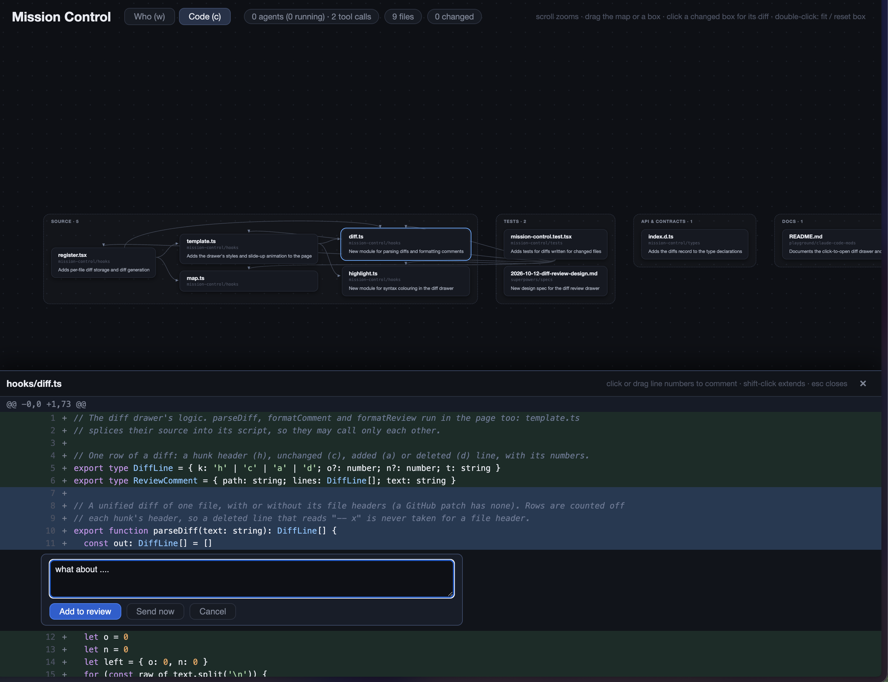
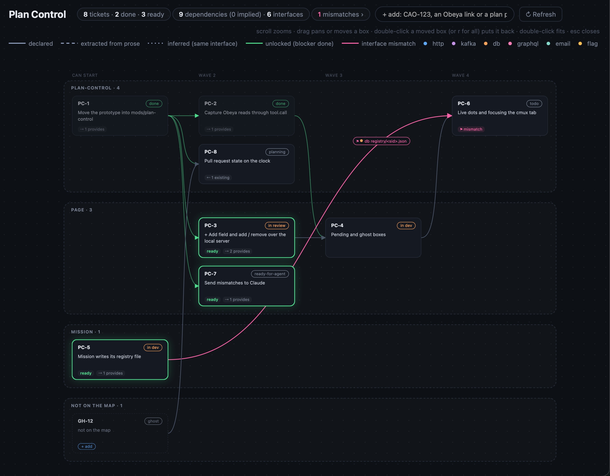
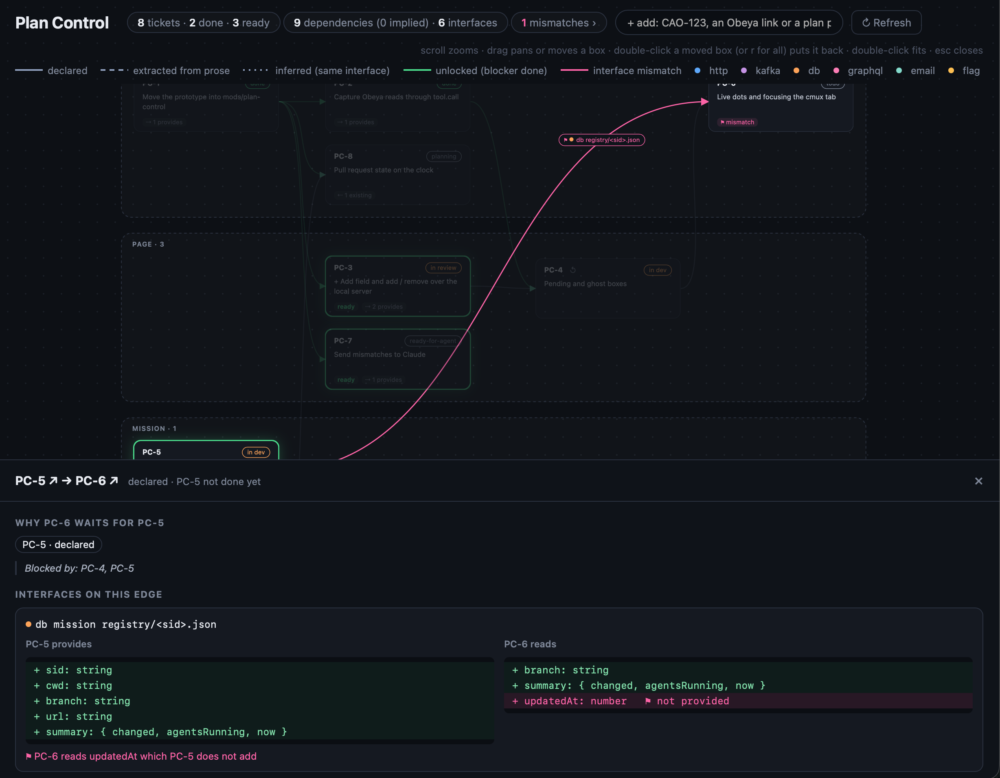

# claude-code-mods

Zhitong's Claude Code mods. Inspired by [hamzafer/claude-code-mods](https://github.com/hamzafer/claude-code-mods) (MIT).

## mission

`/mission` opens a live web page with two tabs, **Who** (the main agent, its subagents and every tool call) and **Code** (a map of the files Claude reads and edits, the imports between them, and one line on why each changed). The page refreshes itself every second. There is no side pane.

It opens in a cmux browser split when run inside cmux, otherwise in your default browser.



<details>
<summary><b>Install</b></summary>

```sh
claude plugin marketplace add zhitongLIU/claude-code-mods
claude plugin install mission@zhitong-mods
```

Restart Claude Code (or run `/reload-plugins`).

</details>

<details>
<summary><b>Commands</b></summary>

| Command | What it does |
| --- | --- |
| `/mission` | Open the page and keep it updated. It opens on the tab you used last (Who the first time). |
| `/mission <base>` | Put the files changed in git on the Code tab once (`HEAD` for the uncommitted changes, or everything against `base`, e.g. `main`), each with a one-line summary of its diff. Works with no turn running. After that the page carries on live from Claude's own work; run it again to refresh. Give a GitHub PR link or `#123` instead of a base to review a pull request without checking it out: it is fetched from `origin` (needs `gh` signed in) and read from git. |
| `/mission findings <file.json> [--add]` | Put the findings of an AI review on the page (see below). `/mission findings clear` takes them off. |
| `/mission off` | Stop updating the page. |

Closing the browser tab does not stop the updates, because the mod cannot see it close. Run `/mission off` when you are done, which also stops the model calls for the "why" lines.

</details>

<details>
<summary><b>Using the page</b></summary>

In the page: `w` Who, `c` Code. On the code map, scroll or pinch to zoom around the pointer, drag to move, double-click (or `0`) to fit it to the window again. Drag a box to pull it out of a tangle of arrows (the arrows follow); a moved box gets a small ↺ button, or double-click it, to put it back, and `r` resets all boxes. Your zoom and box positions are kept while the data refreshes, and box positions are remembered in the browser for that session's page. The tab is kept in the URL hash (`#who`, `#code`).

Click a changed box to slide its diff up from the bottom (the map stays above it); click the box again, the empty map or press `esc` to close it. Press on a line number and drag to take a range of lines (or click one line, shift-click to extend), then **Add to review** or **Send now**. **Send review (n)** at the top sends the comments not yet sent, each with its quoted lines, straight to this Claude session as a prompt. The page is served by a small local Node server on `127.0.0.1` (a token in the URL, one server per session, stopped by `/mission off`); where Node is missing or the server does not start, the page opens from disk and the same buttons copy to the clipboard instead, to paste into Claude or anything else. **Copy (n)** always copies every comment. Sent or copied comments stay on the page, dimmed with a ✓, and are cleared once Claude changes their file again; a comment you have not sent is never dropped, only marked outdated. **Send now** sends a single comment the same way. The review is kept in the browser for that session's page. Diffs come from git (against `HEAD`, the review base, or the pull request); a pull request given as a link uses GitHub's own patch, which GitHub leaves out for very large files.

</details>

<details>
<summary><b>Review findings</b></summary>

Findings from an AI review turn their file's box pink (`⚑ n`) and show under their line in the diff drawer. They come in three ways, whoever wrote the review: the `ReportFindings` call of `/code-review` is picked up on its own; the model calls the `mcp__mission__findings` tool, which the `/mission-findings` skill does from a review already in the conversation; or you load a JSON array of `{ file, line?, summary, scenario?, severity? }` with `/mission findings <file>`. `file` is repo-relative and `line` is on the new side of the diff; a finding with no line, or whose line is not in the diff, sits at the top of the file's drawer. Findings on files the map does not show are counted but not drawn: run `/mission <PR link or base>` first.

To push findings to the pull request, tick the ones you approve (or **Select findings**) and choose **PR** or **Claude** and press **Send to PR (n)** or **Send to Claude (n)**. After a confirmation the mod posts them with `gh` as one review of comments (never an approval or a request for changes); the page sends only the ids, and what is posted is what the mod holds. It needs the local server, a page about a pull request and `gh` signed in; pushed findings are dimmed with a ✓ and cannot be pushed twice.

</details>

<details>
<summary><b>How it works</b></summary>

- `/mission` opens a web page; there is no terminal pane and no screenshot step.
- The page (`hooks/template.ts`) is plain HTML and CSS fed by a small `data.js`, not a hand-built SVG. Text wraps by itself, so nothing is cut with `…`, and restyling means editing HTML/CSS.
- The per-file "why" is asked from the model (haiku) only once `/mission` has opened the page, then once per change.
- Nothing is written until `/mission` runs, and `/mission off` stops it. Writes are skipped when the data has not changed.
- An arrow `A → B` means B uses A (a change in A reaches B), so used files sit on the left and their users to the right. Arrows come from per-language adapters (`hooks/lang.ts`): JS/TS and Python follow relative imports, Ruby follows `require_relative` and the class or module names a file mentions (`RequestPaymentOtp` links to `request_payment_otp.rb`), as Rails loads code by name. Add a language by adding an adapter.
- Each session has its own page folder, so several Claude Code sessions can run `/mission` side by side without sharing data.
- A one-line band above the prompt sums up the turn while Claude works. While the page is served, the band also shows its address: Cmd-click it (or run `/mission` again) to reopen the page after closing the tab.

| File | Role |
| --- | --- |
| `hooks/register.tsx` | Tracks agents, tool calls and files. After `/mission`, writes `index.html` and `hljs.js` once, `data.js` on every change and `diffs.js` when a diff changes, to `$TMPDIR/mission-control/<session id>/`, and opens the page. |
| `hooks/lang.ts` | Language adapters: what each file links to, and which names it defines. |
| `hooks/map.ts` | `mapData()` turns the touched files into plain data: cards by link depth, edges, counts. |
| `hooks/tree.ts` | The Who tree lines. |
| `hooks/template.ts` | The page: tabs, the tree, the card layout and the arrows. Restyle it here. |
| `hooks/diff.ts` | Parses a unified diff into numbered rows and formats review comments. Also runs in the page. |
| `hooks/hl.ts`, `hooks/highlight.ts` | Syntax colours in the diff drawer: `hl.ts` feeds each hunk to highlight.js, `highlight.ts` is the small fallback tint. Both also run in the page. |
| `hooks/vendor-hljs.ts` | [highlight.js](https://highlightjs.org) 11.11.1 (common languages), vendored unchanged for offline use. BSD-3-Clause, © 2006 Ivan Sagalaev. |

</details>

<details>
<summary><b>Develop</b></summary>

```sh
CLAUDE_CONFIG_DIR=$(mktemp -d) claude plugin test mods/mission-control
```

</details>

## plan-control

`/plan-control` opens a live map of a piece of work: Obeya tickets and local plan files, the dependencies between them, the interfaces each one provides and consumes (from the plan's `## Contract` header), mismatches between them, and pull requests. It is meant for the global agent tab; `/mission` stays in each worktree's tab. Design: `docs/superpowers/specs/2026-10-28-plan-control-design.md`.

**See where the work stands.** Each ticket sits in a wave (the ones that can start now, then what each finished wave unlocks) and is grouped by service. Its box shows its status and whether it is ready to start. Green edges mean the blocker is done, and the header counts tickets, done, ready and mismatches.



**Catch plans that don't agree.** When one plan reads an interface (an endpoint, a topic, a table, a file) that another plan provides, the edge between them carries it. If the reader expects a field that the provider never adds, the edge turns pink. Click it to see both sides next to each other, with the missing field flagged, before anyone writes code against it.



<details>
<summary><b>Install</b></summary>

```sh
claude plugin marketplace add zhitongLIU/claude-code-mods
claude plugin install plan-control@zhitong-mods
```

Set where pull requests and ticket links come from in the `env` block of `~/.claude/settings.json`, so they stay out of the repo:

```json
"env": {
  "PLAN_CONTROL_GITHUB_ORG": "your-org",
  "PLAN_CONTROL_TICKET_URL": "https://obeya.example.com/tasks/{key}"
}
```

Restart Claude Code (or run `/reload-plugins`).

</details>

<details>
<summary><b>Commands</b></summary>

| Command | What it does |
| --- | --- |
| `/plan-control` | Open the map of this session. |
| `/plan-control CAO-219` | Add and open in one go. |
| `/plan-control add <ref> …` | Add an Obeya key (a parent brings its sub-tickets; `--only` adds it alone), an Obeya link, a plan `.md` file or a folder of them. The page's **+ add** field does the same. |
| `/plan-control remove <id>` | Take a ticket off the map. |
| `/plan-control refresh` | Ask Claude to read again the Obeya tickets older than 10 minutes, and re-fetch pull requests. |
| `/plan-control maps` / `attach <map>` | List the saved maps; take one over in this session (after a restart). |
| `/plan-control off` | Stop the page. |

</details>

<details>
<summary><b>Using the page</b></summary>

- Green links are unlocked (the blocker is done), pink ones are interface mismatches. **Mismatches ›** lists them; pick which side to fix and **Send to Claude**.
- Local plans open their file (`vscode://file/…`); Obeya ticket keys open `$PLAN_CONTROL_TICKET_URL`, with `{key}` replaced.
- A ticket another one names but the map does not hold is a dashed ghost with **+ add**. When a plan file in the same folder as a plan on the map has that id, the ghost opens the file and **+ add** adds it.

</details>

<details>
<summary><b>How it works</b></summary>

- One map per Claude session, in `~/.plan-control/maps/<session id>.json`. Several epics can run side by side, one global tab each.
- A mod cannot call Obeya: plan-control asks Claude to read a ticket with `obeya_get_task_context` and takes the result as it passes, into the shared cache `~/.plan-control/cache/obeya/`. Claude writes nothing back, so a ticket costs only the tokens of reading it once; any later read, by anyone in any session, refreshes it.
- The `plan-contract` skill teaches agents the Contract format: one bullet per interface, `- **provides** \`db registry/<sid>.json\` \`{ sid, branch }\`` or `- **consumes** \`http /api/x\` from PC-2 \`{ updatedAt:number }\``. It reads well in Obeya and survives its line joining. The older `### Provides` / `### Consumes` lists still work. A Contract bullet that matches neither format shows as **⚑ unread** on the ticket's box.
- Plans without a Contract header can use contracts extracted once, from `~/.plan-control/extracted/*.json`, until the header exists.
- Pull requests come from `gh pr list` on `$PLAN_CONTROL_GITHUB_ORG/<service>`, matched on the ticket key in the branch name, every minute while the page is open (none when the variable is unset).

</details>

<details>
<summary><b>Develop</b></summary>

```sh
CLAUDE_CONFIG_DIR=$(mktemp -d) claude plugin test mods/plan-control
```

</details>

## License

MIT, see [LICENSE](LICENSE). Inspired by [hamzafer/claude-code-mods](https://github.com/hamzafer/claude-code-mods) by Hamza Zafar, whose copyright notice stays in the license.
